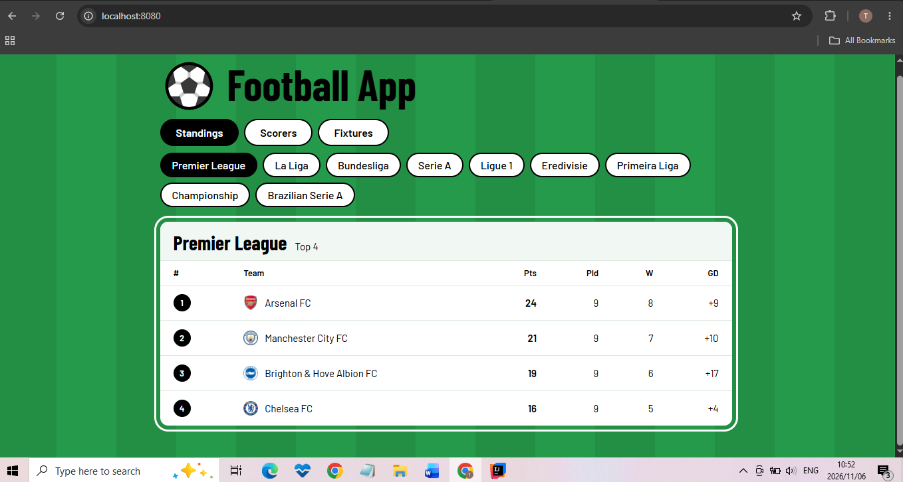

# ⚽ Football App (Spring Boot)

A full-stack football app. A Spring Boot REST API fetches live data from [football-data.org](https://www.football-data.org/) and serves it to a frontend page.

## Features
- Top 4 standings, top scorers and upcoming fixtures
- 9 leagues supported
- Clean JSON endpoints with a `limit` option
- Styled frontend served by the same Spring Boot app

## Endpoints
| Endpoint | Description |
|----------|-------------|
| `/api/standings/{league}/top?limit=4` | Top N teams in the table |
| `/api/scorers/{league}/top?limit=4` | Top N scorers |
| `/api/fixtures/{league}?limit=4` | Upcoming fixtures |

League codes: PL, PD, BL1, SA, FL1, DED, PPL, ELC, BSA

## Tech Stack
- Java 25, Spring Boot, Maven
- Spring `RestClient` for API calls
- HTML, CSS and JavaScript frontend

## How to Run
1. Get a free API key from [football-data.org](https://www.football-data.org/)
2. Set it as an environment variable: `FOOTBALL_API_KEY=your-key`
3. Run `FootballapiApplication`
4. Open `http://localhost:8080`

## Author
Built by [StackOverThiago](https://github.com/StackOverThiago)
